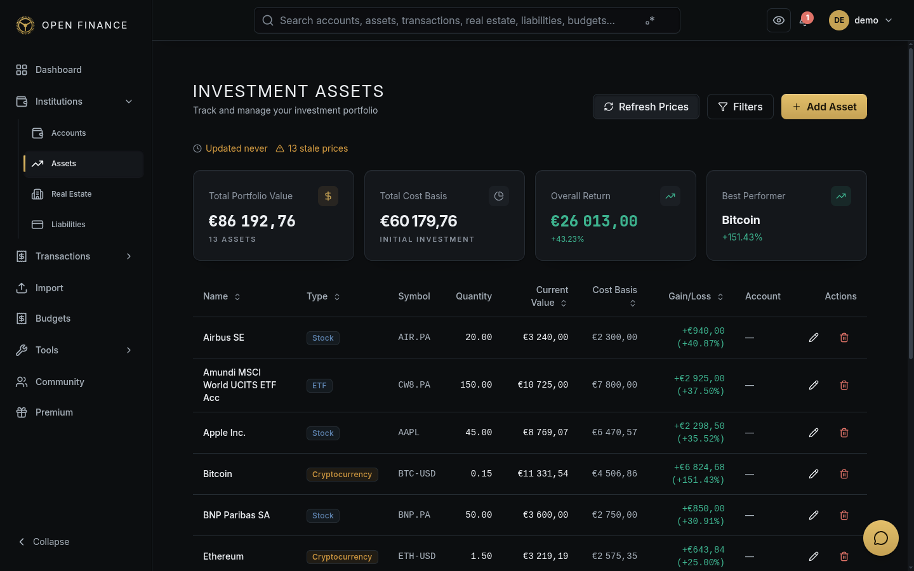

# Asset Management

← [Wiki Home](HOME.md)

---

## Overview

The Asset module tracks your investment portfolio — stocks, ETFs, mutual funds, bonds, cryptocurrencies, commodities, real estate investments, vehicles, jewellery, and collectibles. Live market prices are fetched automatically for assets with a ticker symbol.

---

## Managing belongings and investments

Use **All assets**, **Physical assets**, or **Investments** to choose what you want to manage. Filtering applies before pagination, and the summary follows the selected group. Use the sidebar to open Real Estate or Liabilities.

**Add Asset** starts with a choice of physical item, investment, or property. Physical items start with a quantity of one. Enter the purchase price and estimated current value; brand, condition, warranty, account, and notes are optional. Saving an asset record does not create an account payment. Planned items have a current value of zero until acquired.

Open an item and choose:

- **Costs → Add cost** to record maintenance or an improvement. The item and currency are already selected. Choose the paying account and enter the amount and date. Click an existing cost to open its transaction. Info icons explain the available options. Maintenance leaves cost basis and value unchanged. Improvements increase cost basis and tracked value; you can update the estimated value separately after the work. If a payment already exists in Transactions, edit that transaction to link it instead of recording it again.
- **Linked debt → Link a loan** to select an existing loan or create one. The current item is preselected and receives the unallocated share. Other assets financed by the same loan stay visible, and the total cannot exceed 100%. “Security only” records collateral without allocating debt.

Properties shown in the asset list open their property record for management.

---

## Asset Types

| Type        | Examples                            |
| ----------- | ----------------------------------- |
| Stock       | AAPL, MSFT, GOOGL                   |
| ETF         | SPY, QQQ, VTI                       |
| Mutual Fund | VFIAX, FXAIX                        |
| Bond        | US Treasury bonds, corporate bonds  |
| Crypto      | BTC, ETH                            |
| Commodity   | Gold, Silver, Oil                   |
| Real Estate | REITs, rental property shares       |
| Vehicle     | Cars, motorcycles, boats            |
| Jewelry     | Watches, rings, gemstones           |
| Collectible | Art, antiques, coins, trading cards |
| Other       | Anything else                       |

---

## Asset Condition (Physical Assets)

For physical assets (vehicles, jewellery, collectibles), you can record the item’s condition:

| Condition | Description                    |
| --------- | ------------------------------ |
| New       | Brand new, unused              |
| Excellent | Near-perfect, light use        |
| Good      | Normal wear                    |
| Fair      | Visible wear, fully functional |
| Poor      | Significant wear or damage     |

---

## Key Fields

| Field          | Notes                                          |
| -------------- | ---------------------------------------------- |
| Name           | A label for this asset                         |
| Symbol         | Ticker (e.g., AAPL) for market-tracked assets  |
| Type           | Choose from the asset types above              |
| Quantity       | Number of units or shares                      |
| Purchase Price | Cost per unit when you bought it               |
| Current Price  | Current price per unit; refreshed for assets with a symbol |
| Currency       | Currency of both prices (e.g. EUR for a BTC purchase priced in euros) |
| Purchase Date  | Used to calculate gain/loss and holding period |
| Notes          | Optional free-text notes                       |

---

## Live Price Updates

For assets with a ticker symbol, the shipped configuration refreshes current market prices hourly, including weekends. You can also trigger an immediate refresh using **Refresh Prices** on the Assets page. The administrator can change the schedule; encrypted accounts require a cached encryption key from a recent login.

The detail chart shows daily prices per unit in its displayed currency, converted with the exchange rate for each date. A historical closing price can differ from the latest quote, and today's daily candle can still change. Missing market data or exchange rates are shown as unavailable.

See [Market Data](market-data.md) for details on supported symbols and price sources.

---

## Portfolio Metrics

The dashboard provides several portfolio views:

- **Asset Allocation** — breakdown by asset type (pie chart) with total portfolio value and unrealised gain/loss per asset.
- **Portfolio Performance** — time-weighted and money-weighted returns over a selected period.

---

## Related Pages

- [Market Data](market-data.md)
- [Real Estate](real-estate.md)
- [Dashboard](dashboard.md)
