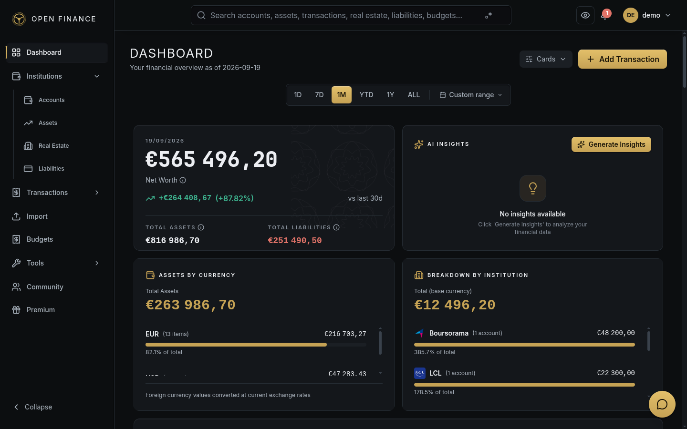
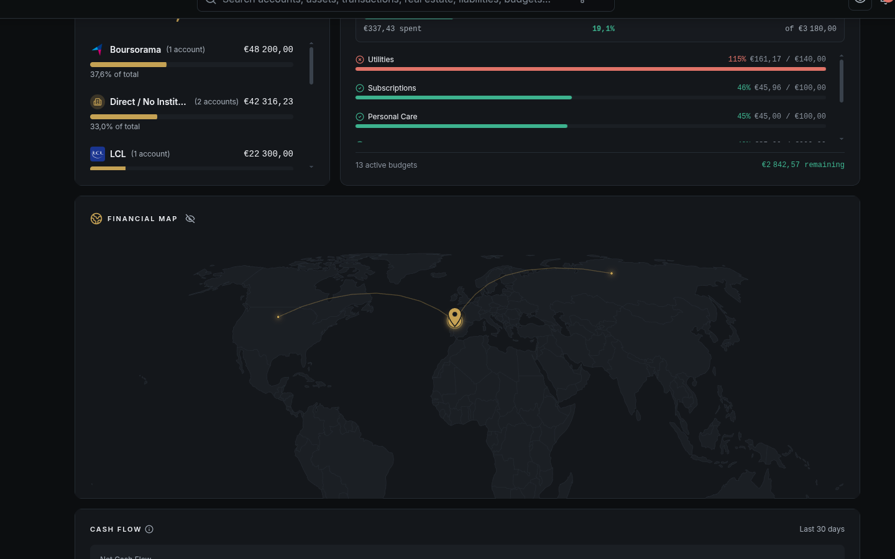

# Dashboard

← [Wiki Home](HOME.md)

---

## Overview

The Dashboard is the central view in Open-Finance. It brings together your accounts, assets, liabilities, budgets, and transactions into a set of widgets that give you an instant snapshot of your financial situation.

---

## Time period and comparisons

The default selection is **MTD** (month to date), from the first of the current month through today. Use **Custom** to select a full calendar month, year, or any other date range, including dates in the future.

The selector has eight options: **1D · 7D · 30D · MTD · YTD · 365D · ALL · Custom**. All date boundaries are inclusive and use local calendar dates.

For example, on **17 October 2026**:

| Selection             | Selected dates                  | Previous period for cash-flow variations |
| --------------------- | ------------------------------- | ---------------------------------------- |
| 1D                    | 17 October                      | 16 October                               |
| 7D                    | 11–17 October                   | 4–10 October                             |
| 30D                   | 18 September–17 October         | 19 August–17 September                   |
| MTD                   | 1–17 October                    | 1–17 September                           |
| YTD                   | 1 January–17 October 2026       | 1 January–17 October 2025                |
| 365D                  | 18 October 2025–17 October 2026 | Preceding 365 days                       |
| Custom → July 2026    | 1–31 July                       | 1–30 June                                |
| Custom → October 2026 | 1–31 October                    | 1–30 September                           |
| Custom → year 2026    | 1 January–31 December 2026      | Full year 2025                           |
| Custom → 1–17 October | 1–17 October                    | 14–30 September                          |
| ALL                   | Available history               | No previous-period comparison            |
| Custom → 10–20 July   | 10–20 July                      | 29 June–9 July                           |

**MTD and YTD:** these presets stop at today and compare the same portion of the preceding month or year. If that date does not exist in the previous period, it is capped at the last available day (for example, 30 March compares through 28 February in a non-leap year). At the end of the month or year, the full previous period is used. Leap-day year-to-date comparisons end on 28 February in a non-leap comparison year.

**Custom ranges:** full calendar months, years, or consecutive groups of whole months use the preceding calendar block, whether or not the selected period has finished. Selecting **1–31 July 2026** compares with **1–30 June**, without including 31 May. Selecting **1–31 October 2026** compares with **1–30 September**, even on 17 October. Other custom ranges compare with the immediately preceding range of equal length. For example, Custom **1–17 October** compares with **14–30 September**, while **MTD** compares with **1–17 September**.

**Future dates:** Custom preserves the exact dates you select. Choosing a future end date does not forecast balances, create future net-worth snapshots, or extend the trend line with zeros or repeated balances. Net Worth Trend ends its axis at the latest available observation, hiding the unobserved tail. The line and change use available observations only, with a **Data through** date when the closing observation is earlier than the selected end. For Custom **1–31 October** on 17 October, the chart ends on **17 October** while the selection and calendar comparison remain **1–31 October** and **1–30 September**. A wholly future range shows no history and no period change. Cash-flow totals and transactions include records dated within the selected range, including any future-dated transactions already entered; they do not generate expected transactions. Estimated earned interest stops at today; its separately labelled next-year forecast is unchanged.

**Card period labels:** captions use compact day counts, with the exact selected dates in a tooltip available on hover, keyboard focus or tap. On 17 October, **MTD** shows **last 17d** (for example, **vs last 17d** on Net Worth), with **1–17 October** in the tooltip. Custom **1–31 October** shows **31d**, with **1–31 October** in the tooltip; custom ranges omit “last” because they can be historical or future. **ALL** remains **all time**. The Custom picker itself continues to display the selected dates.

**Rolling ranges:** 30D and 365D replace the ambiguous 1M and 1Y labels. They always compare equal numbers of days, even when the selected dates happen to match a calendar month. For example, 30D ending on 30 June compares 1–30 June with 2–31 May.

Your selection is remembered within the browser session. Existing saved 1M/1Y selections migrate to 30D/365D; saved custom dates, including future dates, are preserved. Selections saved by the removed Month / Year picker migrate to **MTD** or **YTD** for the current month or year, and to equivalent **Custom** dates for past periods. Rolling and to-date boundaries are recomputed when reopening the dashboard and when the local date changes. **MTD** always follows the current month.

### How the cards use the period

- **Cash Flow, Cash Flow Sankey and Recent Transactions** use the selected dates and share the compact period label with exact dates in its tooltip. Income/expense drill-downs retain those dates and exclude internal transfers. The Sankey shows the exact previous comparison dates beside its variations.
- **Net Worth Trend** uses observations within the selected range: 1D is one daily point, 7D is seven days, and 30D is thirty days when history is available. There is no automatically expanded history window; dates beyond the latest observation are hidden. A single point has no trend comparison.
- **Net Worth** retains today's main total. Its change compares observations at the selected opening and closing dates; when the end lies in the future, it uses the latest available observation in that range and displays its date. Historical selections use their historical closing value. This differs from the Sankey's comparison of activity totals against a preceding period. A single-day selection cannot show an intraday change from daily history.
- **Borrowing Capacity** normalizes the selected income and expenses into monthly averages, alongside current debt payments.
- **Estimated Interest** uses the selected period for estimated earned interest; the next-year projection remains a separate annual forecast.
- **Portfolio Performance** shows current value, cost basis and unrealized gain; period investment returns are unavailable.
- Allocation, currency, institution and map cards show current holdings. Budget Progress follows active budgets' dates. Cash Flow History has its own calendar controls, Balance Variation uses yearly history, and AI Insights and Finance News are independent of this selector.

## Financial Summary

At the top of the Dashboard you’ll find your key figures:

| Metric              | What it shows                                |
| ------------------- | -------------------------------------------- |
| Total Assets        | Sum of all your asset values                 |
| Total Liabilities   | Sum of all outstanding debts                 |
| Net Worth           | Assets minus liabilities                     |
| Net Worth Change    | How your net worth has changed recently      |
| Recent Transactions | Your latest transactions across all accounts |
| Account Summaries   | Per-account balance and recent activity      |

---

## Dashboard Widgets

### Net Worth Over Time

A trend line chart showing your daily net worth over a selected date range. Open-Finance captures a snapshot of your net worth every day, so you can see exactly how it has evolved.

### Cash Flow Analysis

Shows income vs. expenses for a selected period:

- Total income
- Total expenses
- Net cash flow (income minus expenses)
- Monthly breakdown chart

### Spending Breakdown

A pie or donut chart of spending grouped by top-level category, sorted by amount. Quickly see where your money is going this month.

### Asset Allocation

Breaks down your portfolio by asset type (stocks, bonds, crypto, etc.) with percentages and absolute values in your base currency.

### Portfolio Performance

Shows current portfolio value, cost basis and unrealized gain. Period investment returns remain unavailable until portfolio-specific valuation and contribution history can support them.

### Net Worth Allocation

Breaks your net worth into its components:

- Cash & bank accounts
- Investments (stocks, ETFs, crypto, etc.)
- Real estate (net equity)
- Other assets
- Liabilities (shown as a negative)

### Cash Flow Sankey Diagram

A Sankey diagram showing where your money comes from and where it goes — from income sources down through spending categories.

### Borrowing Capacity

An estimate of how much additional borrowing you could take on based on your income, existing repayments, and a debt-to-income ratio.

### Estimated Annual Interest

Total projected interest payable across all your active liabilities for the current year.

### Financial Map

A world map showing where your holdings are located, aggregated by country from your institutions (account balances grouped by each institution's country) and your real estate (properties placed by offline reverse-geocoding of their coordinates, falling back to the address when coordinates are missing). Each country gets a pin sized by the amount held there, your own country (from General settings) is marked with a distinct marker with lines connecting it to each finance location, and hovering a pin shows that country's breakdown. The toggleable legend totals institutions, real estate, and everything combined in your base currency.

### Finance News

A locale-aware RSS feed — English sources for the English UI, French sources for French — showing the latest finance headlines (see [Financial News](news.md)). Clicking a headline opens its summary with a Read Full Article link, each item can be discarded individually, and the Refresh button fetches the latest headlines.

### Assets by Currency

Groups accounts with positive balances by currency, adds assets not linked to an account, and converts foreign currencies to your base currency at current exchange rates, with a progress bar showing each currency's share of the total. Clicking a currency row opens the [Assets](assets.md) page filtered to that currency.

### Breakdown by Institution

Totals your accounts, assets, and liabilities (subtracted) per institution, showing each institution's logo, account count, and share of the total in your base currency. Clicking an institution opens the [Accounts](accounts.md) page filtered to it. A warning appears when some foreign-currency balances lack exchange rates and are excluded.

### Yearly Balance Variation

A year-over-year chart of your net worth from your first transaction year to the most recent, switchable between bar and line views and between total net worth, individual accounts, or institutions. An average yearly change summary sits above the chart, with per-year cards below showing each year's total and variation percentage.

### AI Insights

Shows your top 3 AI-generated insights with priority badges (see [Financial Insights](insights.md)). Clicking an insight opens its full description and each one can be dismissed. When no insights exist, the Generate Insights button analyses your data to create fresh recommendations; once insights exist, Refresh regenerates them.

### Daily Cash Flow

A month calendar where each day shows income (green) and expense (red) bars scaled to the month's maximum, with a tooltip breaking down income, expenses, and net for that day. Clicking a day opens the [Transactions](transactions.md) page filtered to that date; month arrows and a Today button navigate the calendar.

---

## Currency Conversion

All monetary amounts on the Dashboard are automatically converted to your **base currency** using daily exchange rates. You can change your base currency in [Settings](settings.md).

---

## Related Pages

- [Accounts](accounts.md)
- [Assets](assets.md)
- [Liabilities](liabilities.md)
- [Real Estate](real-estate.md)
- [Budgets](budgets.md)
- [Market Data](market-data.md)
