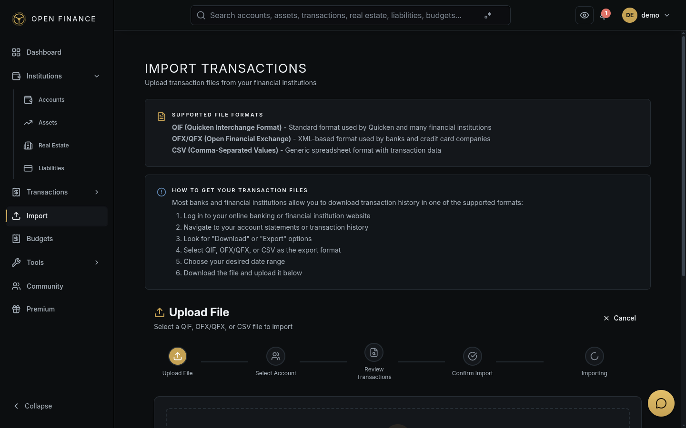

# Import & Export

← [Wiki Home](HOME.md)

---

## Overview

Open-Finance can import transaction history from the most common bank export formats and export all your data in multiple formats for external analysis or migration.

---

## Supported Import Formats

| Format | Extension | Notes                                      |
| ------ | --------- | ------------------------------------------ |
| OFX    | `.ofx`    | Open Financial Exchange — most banks       |
| QFX    | `.qfx`    | Quicken variant of OFX                     |
| QIF    | `.qif`    | Quicken Interchange Format — older format  |
| CSV    | `.csv`    | Comma-separated values — see headers below |

CSV files must include a header row. Supported column names: `date`, `amount`, `currency`, `payee`, `memo`, `category`, `referencenumber`, `account`, `tags`. Rows with missing `date` or `amount` are skipped.

---

## Import Process

### Step 1 — Select Your Files

Go to **Import → Import Transactions**. Select one or more bank export files in the file picker, or drag and drop them together. You can add or remove files before starting. Each file is validated separately against the supported formats and size limit.

Click **Start import** for multiple files, or **Upload File** for one file. Open-Finance uploads and parses every selected file in one import. It tries to match an account for each file and shows those matches together so you can override them before continuing.

### Step 2 — Review the Preview

One preview combines the transactions from all selected files. Each row shows:

- Parsed date, payee, amount, and memo
- Auto-detected category (via [Transaction Rules](transaction-rules.md))
- A **Duplicate** flag if the transaction appears to already exist in your account
- The source file and its selected account

You can adjust categories, exclude specific rows, or override duplicate flags before continuing.

### Step 3 — Confirm

Click **Confirm Import** to save the selected transactions to their accounts. Only the rows you approve are imported.

One confirmation imports the reviewed transactions from all selected files into their chosen accounts. Each file keeps its format-specific data, including currencies and opening balances. Cancelling cancels the entire unfinished import.

Once the files are uploaded and parsed, the combined import can be restored after navigating away or reloading the page.

---

## Duplicate Detection

The importer automatically flags potential duplicates by matching on:

- Same account
- Same date (± 1 day tolerance)
- Same amount
- Matching bank reference ID

Flagged duplicates are highlighted in the preview. You can choose to skip them or import them anyway.

---

## Related Pages

- [Transactions](transactions.md)
- [Transaction Rules](transaction-rules.md)
- [Accounts](accounts.md)
- [Backup & Restore](backup-restore.md)
