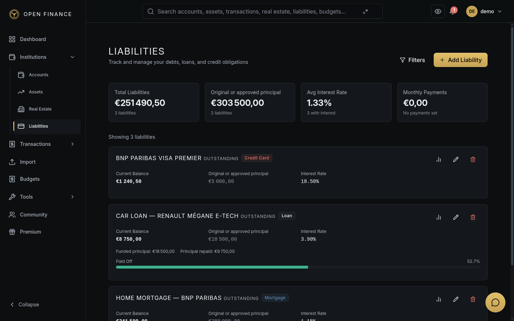

# Liability Management

← [Wiki Home](HOME.md)

---

## Overview

The Liability module tracks money you owe — mortgages, personal loans, student loans, auto loans, credit cards. For each liability, Open-Finance calculates amortization schedules, projects total interest paid, and lets you record interest rate changes over time.

---

## Managing a loan

Start with the loan name, original amount, current balance, currency and start date. Expand **Repayment terms & fees** for interest, insurance, monthly payments and dates, or **Lender & notes** for additional details.

After saving, the loan’s detail view opens. **Linked assets** shows what the loan finances and lets you manage its allocation. The same links can be edited from an asset or property under **Linked debt**. Linking an item does not create a payment or change the loan balance. Payments, the repayment schedule and drawdowns remain in their own sections.

### Receiving a drawdown

Choose **Staged funding → Receive funds**. Enter the amount and date, then choose the destination:

- **Bank account** increases that account's cash balance and the outstanding debt.
- **Direct to seller** records funding against the selected asset or property and increases the debt, without changing your bank balance.

For a direct property payment, select **Add to property cost** when it pays for construction, renovations or improvements not already included in the recorded cost. This adds a dated investment contribution without creating a bank-account transaction or an investment gain.

If you track the property's value at the cost of completed works, also select **Also increase the property value by this amount**. For example, a €22,500 draw adds €22,500 to debt, invested cost and tracked value, with no cash movement or gain. Leave that second option unchecked when an independent valuation already covers the works. Leave both unchecked when the draw only finances a cost already recorded.

Use **Staged funding → Add tranche** to plan a future drawdown. A planned tranche changes neither cash nor debt until it is drawn. Account drawdowns can be edited or deleted through their linked transaction; direct draws can be reversed from **Staged funding**.

Reversing a direct draw also cancels its recorded property cost and value contribution. Earlier history and later independent valuations are preserved. To correct a drawn amount or destination, reverse the draw and record a new one.

---

## Liability Types

| Type          | Description               |
| ------------- | ------------------------- |
| Mortgage      | Home or property loan     |
| Loan          | Generic instalment loan   |
| Personal Loan | Unsecured personal loan   |
| Student Loan  | Education debt            |
| Auto Loan     | Vehicle financing         |
| Credit Card   | Revolving credit facility |
| Other         | Any other debt            |

---

## Key Fields

| Field           | Notes                                         |
| --------------- | --------------------------------------------- |
| Name            | A label for this debt (e.g., “Home Mortgage”) |
| Type            | Choose from the liability types above         |
| Principal       | The original amount borrowed                  |
| Current Balance | Outstanding balance today                     |
| Interest Rate   | Annual rate (%)                               |
| Monthly Payment | Your required monthly payment                 |
| Start Date      | When the loan began                           |
| End Date / Term | Maturity date or term in months               |
| Institution     | Optional link to the institution registry     |
| Insurance       | Optional insurance premium amount             |
| Fees            | Optional recurring fees                       |

---

## Amortization Schedule

Open-Finance generates a month-by-month breakdown of your loan showing:

| Column    | Description                     |
| --------- | ------------------------------- |
| Period    | Month number                    |
| Payment   | Total payment amount            |
| Principal | Portion reducing the balance    |
| Interest  | Portion going to interest       |
| Balance   | Remaining balance after payment |

The table includes **Paid** entries from recorded transactions and **Upcoming** estimates. Use the status filters, pagination, or CSV export to review the history. Future drawdowns and principal repayments change the projected schedule.

---

## Total Interest Projection

The detail page shows:

- Total interest you will pay over the full loan term
- Total cost (principal + interest)
- Projected payoff date based on your current payment schedule

---

## Interest Rate Changes

If your lender changes your interest rate (common with variable-rate mortgages), you can record the change from the liability detail page → **Rate History → Add Rate Change**. Enter the new rate and the effective date. Open-Finance recalculates the remaining amortization schedule from that point forward.

---

## Linking Payments to Transactions

Each monthly payment can be linked to a transaction in your account. This lets you track actual payments made against your amortization schedule.

For a payment already imported or recorded, edit that transaction and select **Linked operation → Loan payment**, then the loan. Do not create another payment for the same bank debit.

The estimated split is available when the entered total matches the loan's calculation. If the lender's actual charges differ, choose **Enter actual breakdown** and enter the statement's principal, interest, insurance, and fee components, with their categories. During an interest-only period, an amount above the estimated charges is not automatically treated as principal.

For a new payment, **Linked payments → Record a repayment** accepts the total paid and the actual principal amount. The total reduces cash; only principal reduces debt. Use the transaction editor when you also need separate categories for interest, insurance, or fees.

---

## Related Pages

- [Real Estate](real-estate.md)
- [Calculators — Loan](calculators.md#loan-calculator)
- [Calculators — Early Payoff](calculators.md#early-payoff-calculator)
- [Dashboard](dashboard.md)
