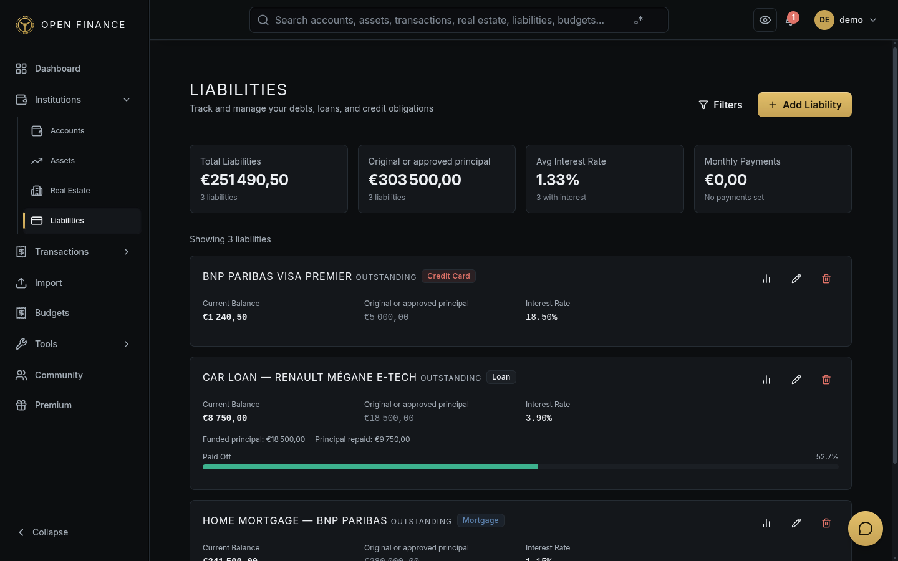

# Liability Management

← [Wiki Home](HOME.md)

---

## Overview

The Liability module tracks money you owe — mortgages, personal loans, student loans, auto loans, credit cards. For each liability, Open-Finance calculates amortization schedules, projects total interest paid, and lets you record interest rate changes over time.

---

## Managing a loan

Start with the loan name, original amount, current balance, currency and start date. Expand **Repayment terms & fees** for interest, insurance, monthly payments and dates, or **Lender & notes** for additional details.

After saving, the loan’s detail view opens. **Linked assets** shows what the loan finances and lets you manage its allocation. The same links can be edited from an asset or property under **Linked debt**. Linking an item does not create a payment or change the loan balance. Payments, the repayment schedule and drawdowns remain in their own sections.

---

## Liability Types

| Type          | Description               |
| ------------- | ------------------------- |
| Mortgage      | Home or property loan     |
| Loan          | Generic instalment loan   |
| Personal Loan | Unsecured personal loan   |
| Student Loan  | Education debt            |
| Auto Loan     | Vehicle financing         |
| Credit Card   | Revolving credit facility |
| Other         | Any other debt            |

---

## Key Fields

| Field           | Notes                                         |
| --------------- | --------------------------------------------- |
| Name            | A label for this debt (e.g., “Home Mortgage”) |
| Type            | Choose from the liability types above         |
| Principal       | The original amount borrowed                  |
| Current Balance | Outstanding balance today                     |
| Interest Rate   | Annual rate (%)                               |
| Monthly Payment | Your required monthly payment                 |
| Start Date      | When the loan began                           |
| End Date / Term | Maturity date or term in months               |
| Institution     | Optional link to the institution registry     |
| Insurance       | Optional insurance premium amount             |
| Fees            | Optional recurring fees                       |

---

## Amortization Schedule

Open-Finance generates a month-by-month breakdown of your loan showing:

| Column    | Description                     |
| --------- | ------------------------------- |
| Period    | Month number                    |
| Payment   | Total payment amount            |
| Principal | Portion reducing the balance    |
| Interest  | Portion going to interest       |
| Balance   | Remaining balance after payment |

This is displayed as a chart and table in the liability detail view.

---

## Total Interest Projection

The detail page shows:

- Total interest you will pay over the full loan term
- Total cost (principal + interest)
- Projected payoff date based on your current payment schedule

---

## Interest Rate Changes

If your lender changes your interest rate (common with variable-rate mortgages), you can record the change from the liability detail page → **Rate History → Add Rate Change**. Enter the new rate and the effective date. Open-Finance recalculates the remaining amortization schedule from that point forward.

---

## Linking Payments to Transactions

Each monthly payment can be linked to a transaction in your account. This lets you track actual payments made against your amortization schedule.

---

## Related Pages

- [Real Estate](real-estate.md)
- [Calculators — Loan](calculators.md#loan-calculator)
- [Calculators — Early Payoff](calculators.md#early-payoff-calculator)
- [Dashboard](dashboard.md)
