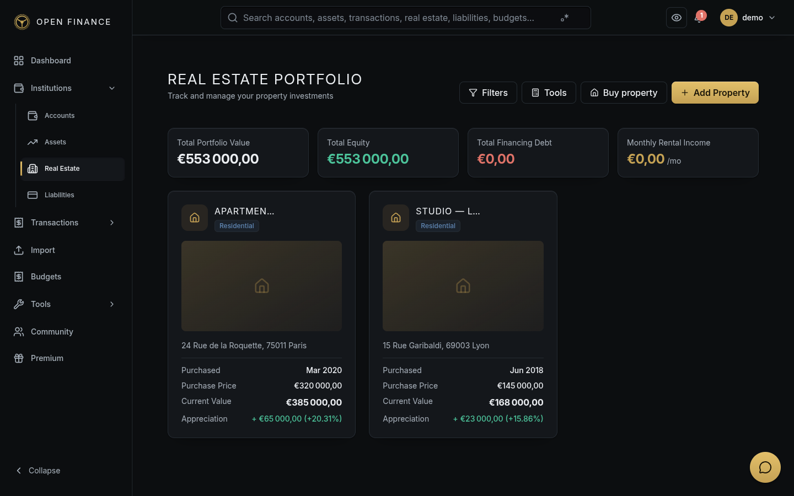
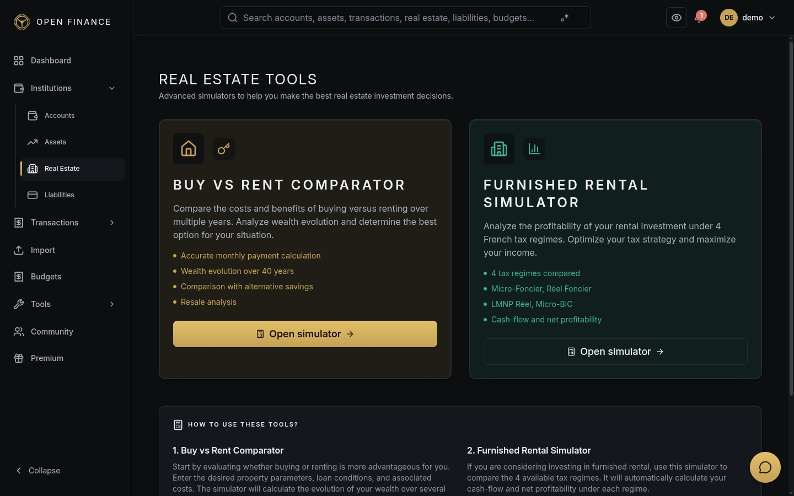

# Real Estate

← [Wiki Home](HOME.md)

---

## Overview

The Real Estate module goes beyond generic asset tracking to provide property-specific features: property type classification, value history, income/expense tracking, mortgage linkage, and investment simulations.

---

## Adding and managing a property

Choose **Add Property**, then select the appropriate workflow:

- **Record a property I already own** creates an ownership record without moving money. Mortgage, rent, map coordinates and notes are optional.
- **Buy a property and record the payment** guides you through the property, funding and review. It suggests the purchase price as the initial value and calculates the cash contribution from the loan amount. Confirming saves the purchase and its funding together.
- **Plan a future property** records the project without adding it to current net worth.

Use the property's edit action to update its details. Open the property to record expenses under **Costs & payments** or manage loans under **Linked debt**. Transactions in **Costs & payments** open their transaction details. A shared loan can finance several assets; its allocation across all of them remains visible when editing links. Equity and ROI analysis have separate sections.

---

## Property Types

| Type        | Description                                     |
| ----------- | ----------------------------------------------- |
| Residential | Primary residence, rental apartment, house      |
| Commercial  | Office, retail, warehouse                       |
| Land        | Undeveloped land or plots                       |
| Mixed Use   | Properties combining residential and commercial |
| Industrial  | Factory, logistics, manufacturing               |

---

## Key Fields

| Field                 | Notes                                                  |
| --------------------- | ------------------------------------------------------ |
| Name                  | Property name or address                               |
| Property Type         | Choose from the types above                            |
| Purchase Price        | Original cost                                          |
| Current Value         | Latest estimated market value                          |
| Purchase Date         | Acquisition date                                       |
| Location              | City / region / country                                |
| Surface Area          | In m² if applicable                                    |
| Income-Generating     | Whether the property produces rental income            |
| Monthly Rental Income | If income-generating, the monthly rent received        |
| Linked Asset          | Optional link to a portfolio asset of type Real Estate |
| Linked Liability      | Optional mortgage linked from the Liabilities module   |

---

## Property Value History

Track how a property’s estimated value changes over time. Each update creates an immutable snapshot. Navigate to the property detail page → **Value History → Add Value** to record a new appraisal.

The value history chart in the property detail view shows how the value has appreciated or depreciated.

---

## Investment Simulations

Use the simulation tool to model a purchase-or-rent scenario for a property.

**Inputs:**

- Purchase price or rental cost
- Down payment amount
- Mortgage rate and term
- Expected annual value appreciation (%)
- Monthly costs (insurance, maintenance, taxes)
- Expected rental yield if bought as an investment

**Outputs:**

- Break-even period (buy vs rent)
- Net present value of ownership over N years
- Total return on investment
- Month-by-month cash flow projection

Simulations are saved and can be revisited for comparison.

---

## Equity Calculation

For properties with a linked mortgage, equity is calculated automatically:

> **Equity = Current Value − Outstanding Mortgage Balance**

This feeds into the net-worth dashboard, where real estate equity is shown alongside your other assets.

---

## Real Estate Tools

The Real Estate module also includes specialized tools for analyzing property investments and market trends.

---

## Related Pages

- [Assets](assets.md)
- [Liabilities](liabilities.md)
- [Dashboard](dashboard.md)
